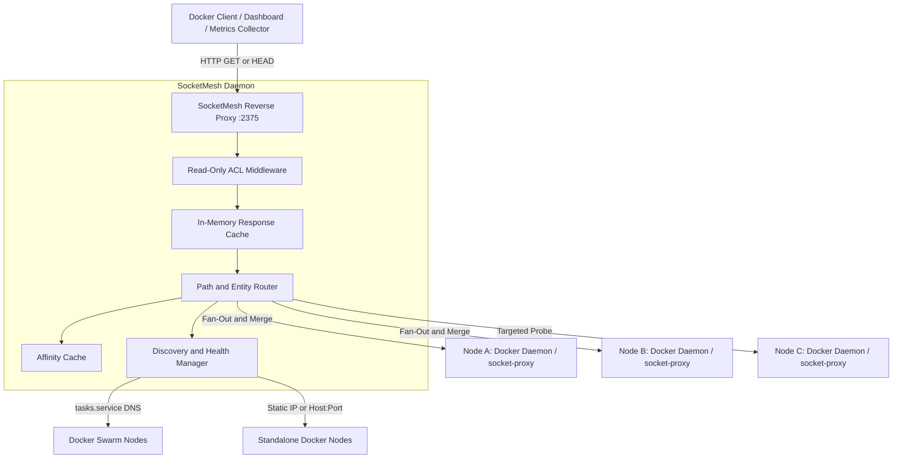

# SocketMesh

SocketMesh is a lightweight, read-only Docker API multiplexer and reverse proxy. It aggregates multiple Docker daemons—either standalone hosts or nodes in a Docker Swarm cluster—into a single unified Docker API endpoint (`:2375`).

SocketMesh is designed for monitoring dashboards, metrics collectors (such as Prometheus exporters, cAdvisor, Portainer in read-only mode, or Homarr), and inventory tools that need cluster-wide visibility across multiple Docker nodes without write access or Docker socket exposure.



---

## Key Features

- **Strictly Read-Only Security Model**: Only `GET` and `HEAD` requests are permitted. All mutating methods (`POST`, `PUT`, `DELETE`, `PATCH`, `OPTIONS`, `CONNECT`, `TRACE`) are blocked at the gateway with `403 Forbidden`. SocketMesh cannot modify, create, stop, or delete containers.
- **Drop-in ACL Compatibility**: Supports the granular ACL environment variables and flags popularized by `linuxserver/socket-proxy` and `tecnativa/docker-socket-proxy` (`CONTAINERS=1`, `IMAGES=1`, `INFO=1`, etc.).
- **Flexible Downstream Discovery**:
  - **Static Hosts**: Specify fixed IP addresses or hostnames (`HOSTS=node1:2375,node2:2375`).
  - **Docker Swarm DNS**: Automatically resolve Swarm service tasks via overlay network DNS (`SWARM_SERVICE=socket-proxy` resolves `tasks.socket-proxy`).
  - **Hybrid**: Mix static standalone hosts and Swarm services simultaneously.
- **Active Health Monitoring & Fault Tolerance**: Periodically probes downstream nodes with `GET /_ping`. If a node crashes or disconnects, SocketMesh automatically marks it unhealthy and routes traffic across the remaining nodes without breaking cluster aggregation.
- **Intelligent Entity Routing**:
  - **Fan-Out & Merge**: Aggregates lists across all nodes (`/containers/json`, `/images/json`, `/networks`, `/volumes`, `/version`).
  - **Cluster Info Aggregation**: Combines total CPU count, memory, and container state counts into a unified `/info` response.
  - **Entity Affinity Caching & Fast Fallback Probing**: Inspect requests (`/containers/{id}/json`, `/containers/{id}/logs`, etc.) are routed directly to the node hosting the entity.
  - **Swarm Manager Failover**: Automatically identifies Swarm managers, skipping worker nodes returning `503 Service Unavailable`.
- **Optional In-Memory Response Caching**: Reduce daemon CPU load under high scraping frequencies (`CACHE_TTL=5s`).
- **Minimal Alpine Footprint**: Distributed as an unprivileged, statically compiled Go binary with a built-in `--healthcheck` mode.

---

## Routing Architecture

| Strategy | Endpoints | Behavior |
| :--- | :--- | :--- |
| **Fan-Out & Merge** | `GET /containers/json`<br>`GET /images/json`<br>`GET /networks`<br>`GET /volumes`<br>`GET /version` | Queries all healthy downstreams in parallel. Merges lists and deduplicates entities by ID. Updates entity affinity cache with observed container and network locations. |
| **Cluster Info Aggregation** | `GET /info` | Fans out across all healthy nodes. Sums container counts (running, paused, stopped), image counts, total CPU cores, and total memory. Merges driver and system status. |
| **Targeted Routing** | `GET /containers/{id}/*`<br>`GET /networks/{id}`<br>`GET /volumes/{name}`<br>`GET /images/{id}/*` | Checks the in-memory affinity cache to route directly to the owning node. On cache miss, sends concurrent `HEAD`/`GET` probes across healthy nodes, caches the owner, and proxies the request. |
| **Swarm Manager Routing** | `GET /services/*`<br>`GET /tasks/*`<br>`GET /nodes/*`<br>`GET /swarm/*`<br>`GET /secrets/*`<br>`GET /configs/*` | Routes to an identified Swarm Manager. If a downstream node responds with `503` ("not a swarm manager"), SocketMesh fails over to the next healthy node and caches the active manager. |
| **Any-Healthy Node** | `GET /_ping`<br>`GET /distribution/*` | Forwards to any currently healthy downstream endpoint. |

---

## Configuration Reference

Configuration can be provided through environment variables or CLI flags. CLI flags take precedence over environment variables.

### Core Settings

| Environment Variable | CLI Flag | Default | Description |
| :--- | :--- | :--- | :--- |
| `LISTEN_ADDR` / `PORT` | `--listen` | `:2375` | Address and port to bind the proxy server. |
| `HOSTS` | `--hosts` | `""` | Comma-separated downstream hosts (`10.0.0.1:2375,10.0.0.2:2375`). |
| `SWARM_SERVICE` / `SWARM_SERVICES` | `--swarm-service` | `""` | Comma-separated Swarm service names (`socket-proxy` or `socket-proxy:2375`). |
| `DNS_REFRESH` | `--dns-refresh` | `15s` | Interval for re-resolving Swarm `tasks.<service>` DNS records. |
| `HEALTH_INTERVAL` | `--health-interval` | `10s` | Interval between background `/_ping` health checks. |
| `TIMEOUT` / `REQUEST_TIMEOUT` | `--timeout` | `0s` (disabled) | Downstream HTTP request timeout. |
| `CACHE_TTL` | `--cache-ttl` | `0s` (disabled) | TTL for caching read responses in memory. |
| `LOG_LEVEL` | `--log-level` | `info` | Logging verbosity (`debug`, `info`, `warn`, `error`). |
| `HEALTHCHECK` | `--healthcheck` | `false` | Run one-shot health check against the local daemon and exit. |

### Access Control List (ACL)

ACL variables accept `1`, `true`, `yes` (enabled) or `0`, `false`, `no` (disabled).

| Environment Variable | CLI Flag | Default | Allowed Docker API Endpoints |
| :--- | :--- | :--- | :--- |
| `CONTAINERS` | `--containers` | `0` | `/containers/*` (list, inspect, logs, top, stats, changes, archive) |
| `IMAGES` | `--images` | `0` | `/images/*` (list, inspect, history, search) |
| `NETWORKS` | `--networks` | `0` | `/networks/*` (list, inspect) |
| `VOLUMES` | `--volumes` | `0` | `/volumes/*` (list, inspect) |
| `INFO` | `--info` | `0` | `/info` (cluster-aggregated system info) |
| `VERSION` | `--version` | `0` | `/version` (API version and multi-node engine components) |
| `PING` | `--ping` | `1` | `/_ping` |
| `SERVICES` | `--services` | `0` | `/services/*` (Swarm services) |
| `TASKS` | `--tasks` | `0` | `/tasks/*` (Swarm tasks) |
| `NODES` | `--nodes` | `0` | `/nodes/*` (Swarm nodes) |
| `SWARM` | `--swarm` | `0` | `/swarm/*` (Swarm cluster state) |
| `SECRETS` | `--secrets` | `0` | `/secrets/*` (Swarm secret metadata) |
| `CONFIGS` | `--configs` | `0` | `/configs/*` (Swarm config metadata) |
| `SYSTEM` | `--system` | `0` | `/system/df` (Disk usage) |
| `DISTRIBUTION` | `--distribution` | `0` | `/distribution/*` (Registry manifest/image info) |
| `PLUGINS` | `--plugins` | `0` | `/plugins/*` (Docker plugins list) |
| `EVENTS` | `--events` | `0` | *Not implemented* (returns `501 Not Implemented`) |

---

## Usage Examples

### 1. Docker Compose (Multiple Standalone Nodes)

In this scenario, multiple standalone hosts run `socat` or `docker-socket-proxy` to securely expose their Docker sockets over a private internal network. SocketMesh aggregates them into a single endpoint:

```yaml
services:
  socketmesh:
    image: socketmesh:latest
    ports:
      - "2375:2375"
    environment:
      - HOSTS=192.168.1.10:2375,192.168.1.11:2375,192.168.1.12:2375
      - CONTAINERS=1
      - IMAGES=1
      - NETWORKS=1
      - VOLUMES=1
      - INFO=1
      - VERSION=1
      - CACHE_TTL=5s
      - LOG_LEVEL=info
    restart: unless-stopped
```

### 2. Docker Swarm Stack

Deploy SocketMesh as a service within an overlay network. Each node in the swarm runs a local agent or socket-proxy exposing the socket on the overlay:

```yaml
version: "3.8"

services:
  # Deployed to all nodes to expose the local socket to the overlay network
  node-proxy:
    image: tecnativa/docker-socket-proxy
    environment:
      - CONTAINERS=1
      - IMAGES=1
      - NETWORKS=1
      - VOLUMES=1
      - INFO=1
      - VERSION=1
    volumes:
      - /var/run/docker.sock:/var/run/docker.sock:ro
    networks:
      - socketmesh-net
    deploy:
      mode: global

  # SocketMesh aggregates all tasks via Swarm DNS discovery
  socketmesh:
    image: socketmesh:latest
    environment:
      - SWARM_SERVICE=node-proxy
      - DNS_REFRESH=10s
      - CONTAINERS=1
      - IMAGES=1
      - NETWORKS=1
      - VOLUMES=1
      - INFO=1
      - VERSION=1
      - SERVICES=1
      - TASKS=1
      - NODES=1
      - SWARM=1
    networks:
      - socketmesh-net
    ports:
      - target: 2375
        published: 2375
        mode: host
    deploy:
      replicas: 1
      placement:
        constraints:
          - node.role == manager

networks:
  socketmesh-net:
    driver: overlay
    attachable: true
```

### 3. CLI Invocations

Run directly as a binary:

```bash
# Basic standalone aggregation
socketmesh --hosts 10.0.0.1:2375,10.0.0.2:2375 --containers --images --info

# Running with Swarm discovery and in-memory cache
socketmesh \
  --swarm-service tasks.socket-proxy:2375 \
  --containers \
  --images \
  --networks \
  --volumes \
  --info \
  --cache-ttl 5s \
  --log-level debug

# Docker container healthcheck mode
socketmesh --healthcheck --listen :2375
```

---

## Limitations & Design Notes

### 1. Strictly Read-Only Architecture
SocketMesh intentionally prohibits all write operations. Any attempt to send `POST`, `PUT`, `DELETE`, `PATCH`, or `CONNECT` requests (e.g. `docker run`, `docker stop`, `docker exec`) returns `403 Forbidden`. If mutating environment variables from earlier socket proxies (e.g. `POST=1`, `BUILD=1`, `EXEC=1`) are detected, SocketMesh emits a prominent warning at startup reminding operators that write requests will not be passed downstream.

### 2. The `/events` Endpoint
Real-time event streaming (`GET /events`) is intentionally not implemented and returns `501 Not Implemented`. Multiplexing long-lived, stateful HTTP streams from dozens of distinct Docker engines without an intermediary broker causes unbounded memory growth, head-of-line blocking, and broken reconnect guarantees. Dashboards should poll `/containers/json` at regular intervals instead.

### 3. Container & Volume Name Collisions
Standalone Docker daemons manage container names locally. If two disparate standalone nodes run containers named `/web-app`:
- `/containers/json` returns both containers, each retaining its unique 64-character `Id`.
- Targeted lookups by full ID (`/containers/<64-char-id>/json`) or short ID (`/containers/<12-char-id>/json`) route unambiguously to the correct node.
- Targeted lookups using the duplicate name (`/containers/web-app/json`) resolve deterministically to whichever node responds first and remain bound to that node via affinity caching.

### 4. Swarm Manager Routing & Worker Failover
Swarm cluster endpoints (`/services`, `/tasks`, `/nodes`, `/swarm`, `/secrets`, `/configs`) can only be serviced by Swarm Manager nodes. When downstreams are deployed as a global Swarm service, worker nodes return `503 Service Unavailable` ("This node is not a swarm manager"). SocketMesh automatically detects this response, fails over across healthy endpoints until a manager node answers, and caches the manager's address for subsequent Swarm requests.
